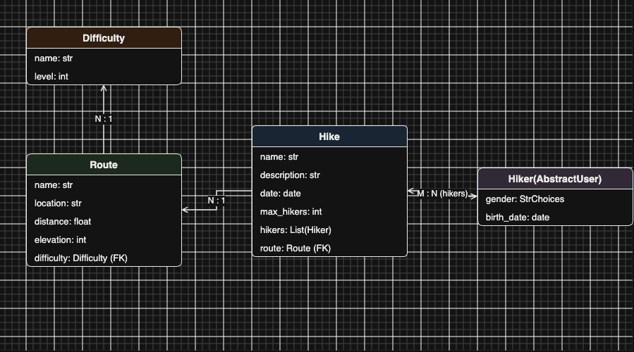
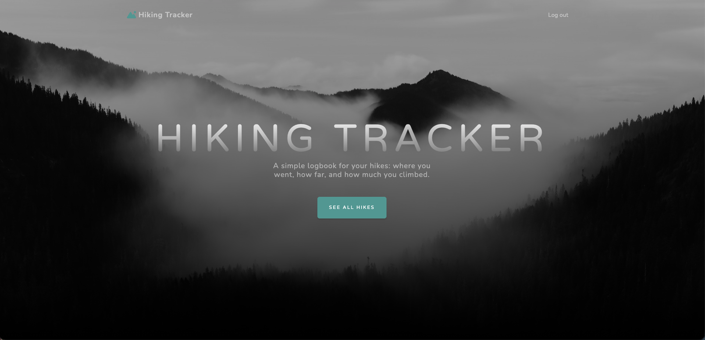
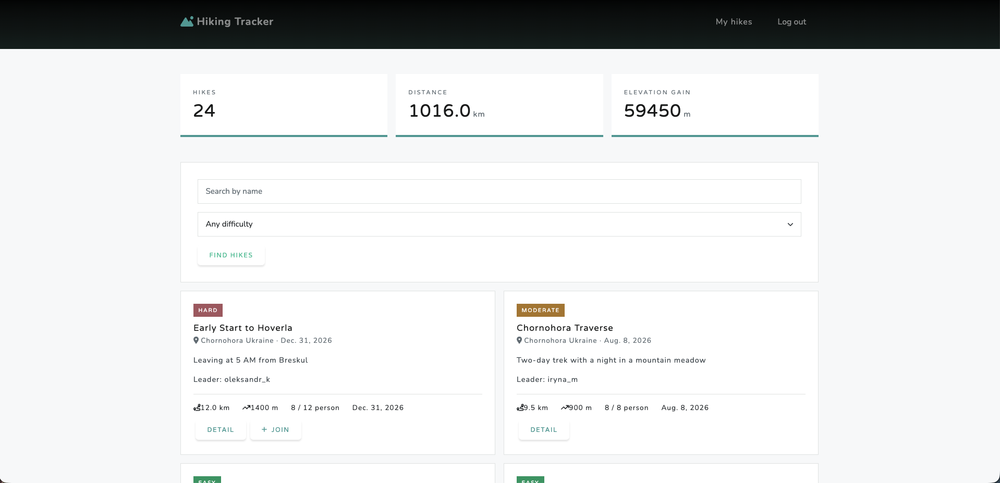
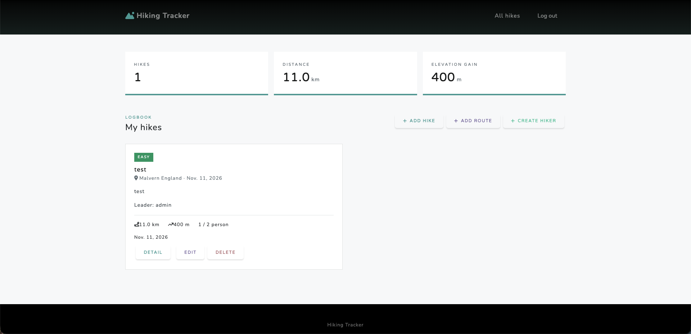

# Hiking Tracker


A Django web application for organizing hiking trips, managing participants, and exploring hiking routes.

## Features

- Browse hiking trips with pagination.
- View route distance and elevation information.
- Manage relationships between hikes and participants.
- Track participant counts and maximum capacity.
- Authentication-protected hiking list.
- Search and filtering functionality.

## Tech Stack

- Python
- Django
- Django ORM
- HTML, Django Templates, Bootstrap 5 (`django-crispy-forms`)
- SQLite (default)

## Project Structure

```
hiking_tracker/      # Django project settings, URLs, WSGI/ASGI entrypoints
tracker/             # Main app: models, views, forms, admin, tests
templates/           # HTML templates (tracker pages, auth, includes)
static/              # CSS, JS, and image assets
data.json            # Sample fixture data
```

## Data Models

- **Hiker** — custom user model (extends `AbstractUser`) representing a participant.
- **Difficulty** — difficulty level (name + numeric level) associated with a route.
- **Route** — route details: name, location, distance, elevation, and difficulty (`ForeignKey`).
- **Hike** — a trip: name, description, date, capacity, route (`ForeignKey`), owner, and participants (`ManyToMany` to `Hiker`). Enforces capacity limits when adding hikers.



## Screenshots

### Home Page


### Hike List


### User Profile


## Installation

```bash
git clone https://github.com/perehinets/hiking-tracker
cd hiking-tracker

python3 -m venv .venv
source .venv/bin/activate

pip install -r requirements.txt
python manage.py migrate
python manage.py createsuperuser
```

Optionally load sample data:

```bash
python manage.py loaddata data.json
```

Run the development server:

```bash
python manage.py runserver
```

Open http://127.0.0.1:8000/ in your browser.

## Running Tests

```bash
pytest
```

## Purpose

This project demonstrates practical experience with Django models, ORM relationships, class-based views, authentication, pagination, and database queries.
